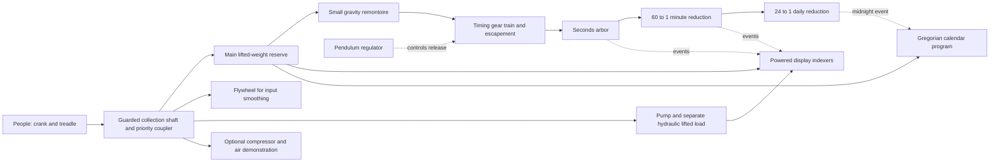

<!-- SPDX-License-Identifier: LicenseRef-Simpli-Noncommercial-1.0 -->
# Zero-Reserve Regulated Calendar — mechanism proposal

Status: **reviewed conceptual kinematics, not a dimensioned or proven physical clock**. Read [objectives](OBJECTIVES.md), [research/evidence](RESEARCH.md) and [energy/reliability](ENERGY-AND-RELIABILITY.md). The proposed combination is ours to develop; the individual principles are established mechanism families, not claimed inventions.

## Architecture and power/control separation

Solid arrows are energy paths; dotted arrows are timing/control events. The regulator gates energy supplied by the reserve; the pendulum is not the motor for heavy date wheels. The timing and display branches are coupled through defined releases, with burst loads isolated from the regulator. Refill and carry events need reviewed torque isolation; a remontoire is a hypothesis to improve drive consistency, not a promise of accuracy.

The proposed [Three-Reserve Priority Coupler](DECISIONS.md#distinctive-proposal-three-reserve-priority-coupler) prioritizes timing reserve, then hydraulic intermittent work, then a surplus air demonstration. It needs a real selector/linkage, clutch sequencing and hysteresis; the diagram is a conceptual energy/control graph, not proof that those parts are solved.

Primary energy storage is a lifted weight. A small gravity remontoire gives the escapement a shorter, repeatable drive interval. Hydraulic and air branches demonstrate useful alternatives without silently loading the precision branch. The main machine can continue while the people rest only while finite reserve remains.

## Regulator and train

Baseline study: a low-amplitude gravity pendulum, a deadbeat-style escapement to be geometrically developed, and a 30-tooth escape wheel with **two alternating half-tooth releases per tooth**. A 2-second full pendulum period gives one beat/second and 6° escape-wheel advance per beat. The escape/seconds arbor therefore averages one revolution/minute. Ideal `T≈2π√(L/g)` suggests about 0.994 m effective length at `g=9.81`; this is an idealized calculation, not a built-clock dimension or accuracy claim. Amplitude, suspension, air drag, temperature, local gravity, support motion and escapement errors remain part of the study.

| Connection | Tooth counts and motion | Required drawing/detail |
| --- | --- | --- |
| Seconds arbor → intermediate A → minute arbor | 20 drives 120; coaxial 20 drives 200. Two external meshes give +1/60. | Coaxial rigid coupling, common tooth pitch per mesh, clearance, center distances and backlash. |
| Minute arbor → intermediate B → daily arbor | 20 drives 120; coaxial 20 drives 80. Two meshes give +1/24. | Distinct shafts/planes so gears do not intersect. Daily reference completes one turn/day. |
| Escapement → S60 seconds register | One 6° release per second produces sixty stable positions/minute. | Loaded impulse/lock intervals, pallet normals, escape-tooth phase and register load isolation. |
| Minute event → M60 register | A once-per-revolution seconds-arbor event releases one 6° register step/minute. | Detent, index cam, power branch and dwell. It is not rigidly geared to an intermittently moving ring without a suitable indexer. |
| Hour event → H24 register | A once-per-revolution minute-arbor event releases one 15° step/hour. | Twenty-four-state 00–23 carrier avoids an incorrect simple decimal hour carry. |
| Midnight → calendar | One event per full daily reference revolution, phase-set to local/selected-basis midnight. | Interlock prevents duplicate/skipped carries; display bursts draw from reserve, not the pendulum. |

These ratios establish average kinematics only. Tooth profiles, center distances, backlash, contact ratio, shaft support and torque must be designed and checked before art is called mechanically authentic. Decorative gears must either mesh with correct speed/sign/phase or be explicitly disconnected idle parts. The input flywheel can rotate smoothly while being driven/coasting; the escapement and its train have locking/release motion. Do not animate the entire connected timing train as arbitrary continuous rotation.

## Calendar and long-period registers

- Registers: **S60** seconds, **M60** minutes, **H24** hours, **D31** day-of-month, **MO12** month and four decimal year wheels. The primary browser display also respects the existing 12/24 preference, showing AM/PM when needed. A future physical 12-hour presentation needs its own reduction/selector and noon/midnight distinction; formatting is not a magical mechanical ratio change.
- A 12-position month program selects nominal length 31/30/February. A proposed **400-position annual program wheel** selects the leap condition, including centuries. It advances once at year carry; its February output has 97 active years per full cycle. An annual sector is 0.9°, so robust manufacture, follower width and index accuracy remain unresolved. A stacked 4/100/400 cam arrangement is a research alternative, not an additional default mechanism.
- On the last day of a month of length `L`, the D31 carrier advances `32−L` positions to reach 01: 1 step after 31, 2 after 30, 3 after 29 or 4 after 28. One wrap generates one month carry; month 12→01 generates one year carry. Mask transitional invalid dates while indexing. Never show “February 30” as the clock's readable date.
- Month/year changes use a staged interlock: release → advance day → carry month/year if needed → update program phase → detent/check. On January 1 the year program must correspond to the new year before February is evaluated. This sequencing and simultaneous carry load are E2 prototype gates, not solved hardware.
- A four-digit physical year module has a finite display range. The first scene supports years 0001–9999 with explicit out-of-range handling; it must not silently wrap 9999 to 0000. The 400-year calendar cycle is not a promise of infinite year display or of historical calendar correctness before local Gregorian adoption.
- Day-of-week is optional later; if added, 146097 days is exactly 20871 weeks. No lunar/astronomical complication is implied by “calendar.”

## Browser accuracy and truthful visual causality

The **browser's current device/local clock remains authoritative**. The scene does not improve the host clock's synchronization. A physical free-running oscillator would have drift and require rate/setting correction. Calendar gearing alone does not know changing timezone law, DST or future UTC policy.

The main glass reading panel presents complete current `HH:MM:SS` and `YYYY-MM-DD`, with HH:MM dominant and explicit 12/24/AM-PM treatment. This panel is the observer's current-time reading, not evidence that a simulated pendulum achieved that accuracy. Behind it, exposed mechanical registers show their stable current value; during finite-duration indexing their slots are shuttered so old/future/transitional values do not compete with the authoritative reading. A physically moving drum cannot change all visible digits instantaneously: this observer/mechanism distinction resolves that real constraint instead of pretending it away.

The physical study must declare a uniform-time/fixed-offset basis. Its constant daily ratio cannot track a 23/25-hour DST day without an explicit correction. In the browser, local civil reading and uniform elapsed phases are separate inputs; a discontinuity reconstructs or deliberately corrects the illustrated state.

Normal gear phases and carry sequences derive from one sampled clock snapshot. Events at seconds/minutes/midnight reconstruct deterministically; frame rate must not decide tooth counts or calendar state. Resume, resize, DST or manual jumps reconstruct a settled mechanism for the new reading without fast-forwarding thousands of crank cycles. In design/study views, explicitly identify reconstruction/correction; it is not energy-conserving physical motion. A future setting train would isolate drive, reposition registers and re-engage deliberately; its work and external time reference must be modeled if physical accuracy is claimed.

## Required proof cases

Check 09→10 seconds, 59 seconds→next minute, 59 minutes→next hour, 23:59:59→next day, each 28/29/30/31-day ending, December/year carry, 1900 and 2100 common years, 2000 and 2400 leap years, the 2099→2100 and 2399→2400 transitions, the complete 400-year program and finite year-display overflow. Include 12-hour noon/midnight, DST skipped/repeated hours, negative/large clock jumps and paused/quiet current readings. A preview must expose train ratio, cam phase, reserve/load and contact diagnostics without putting implementation details into the everyday clock interface.
